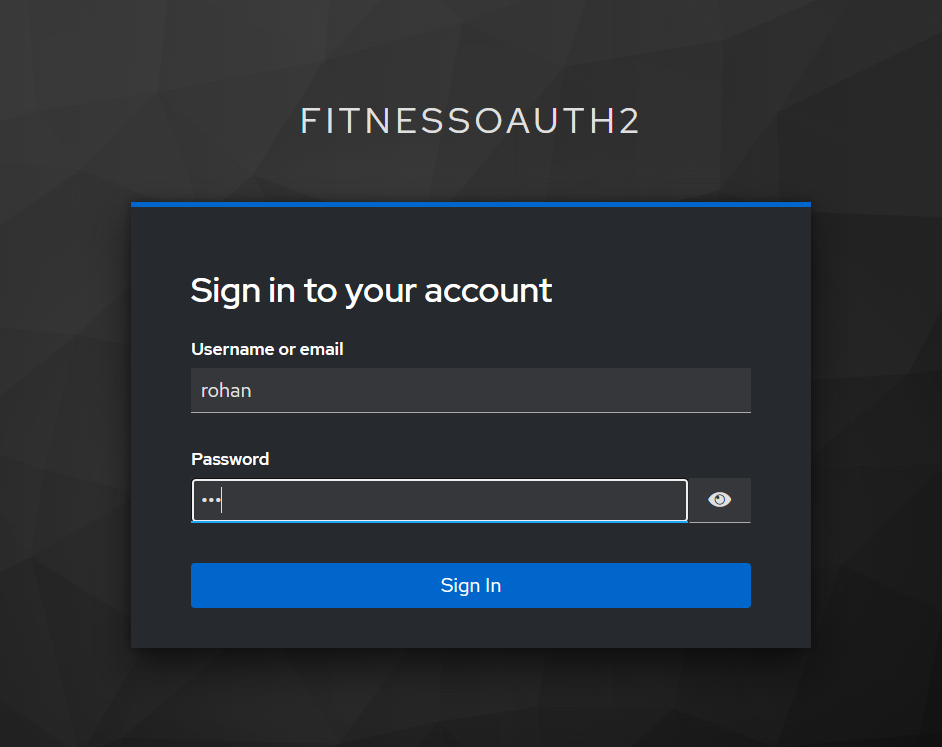
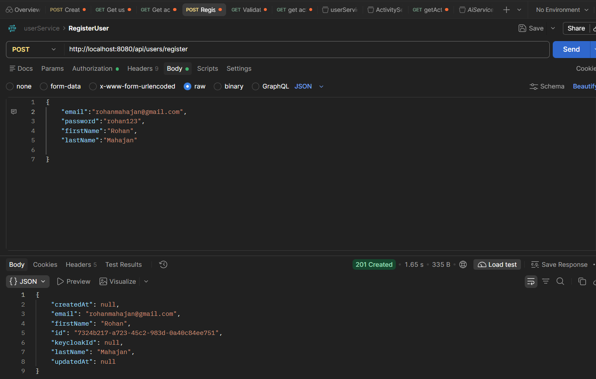
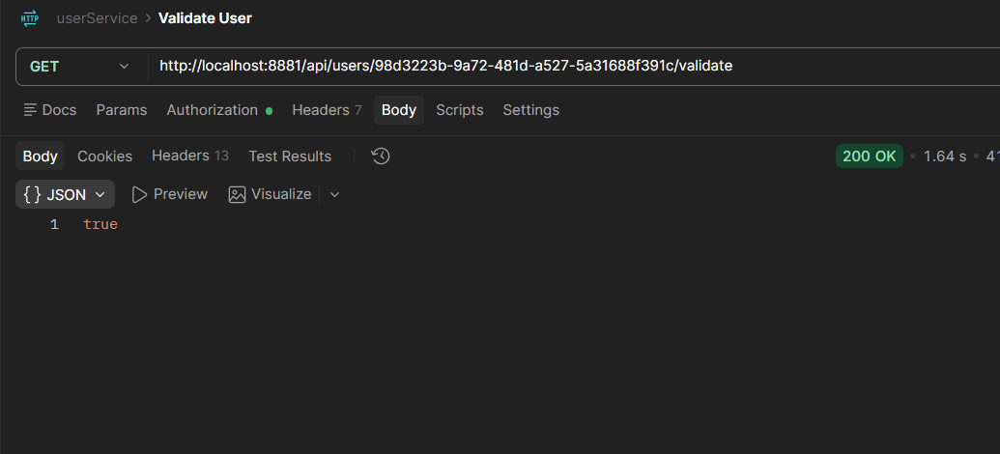
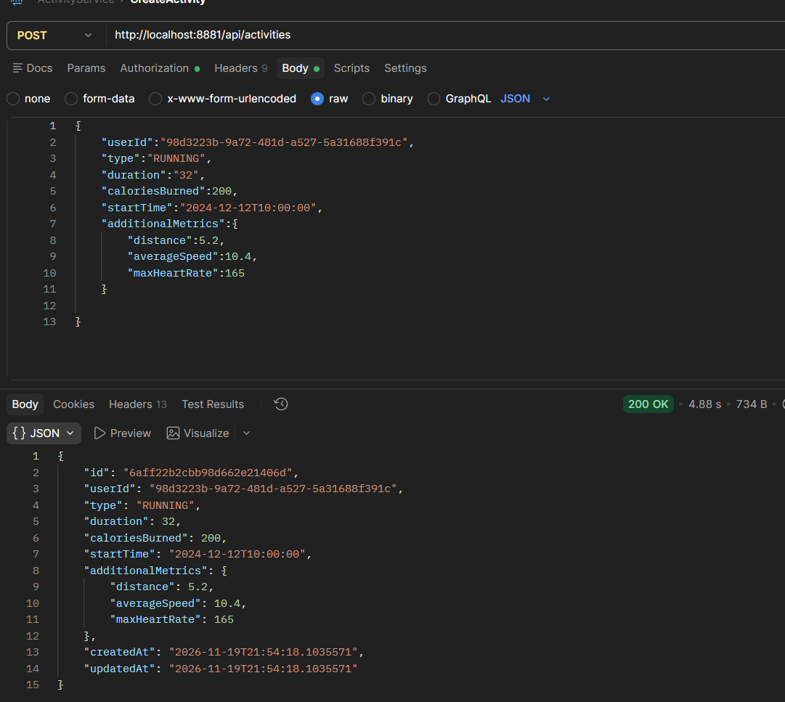
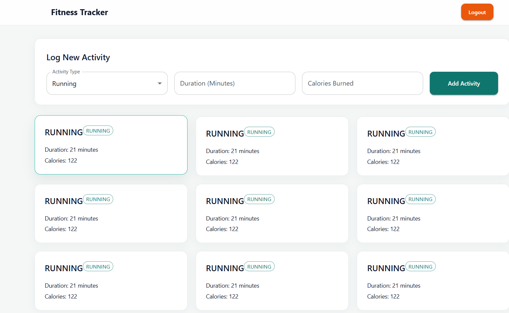
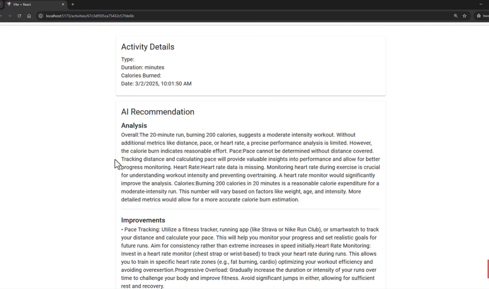
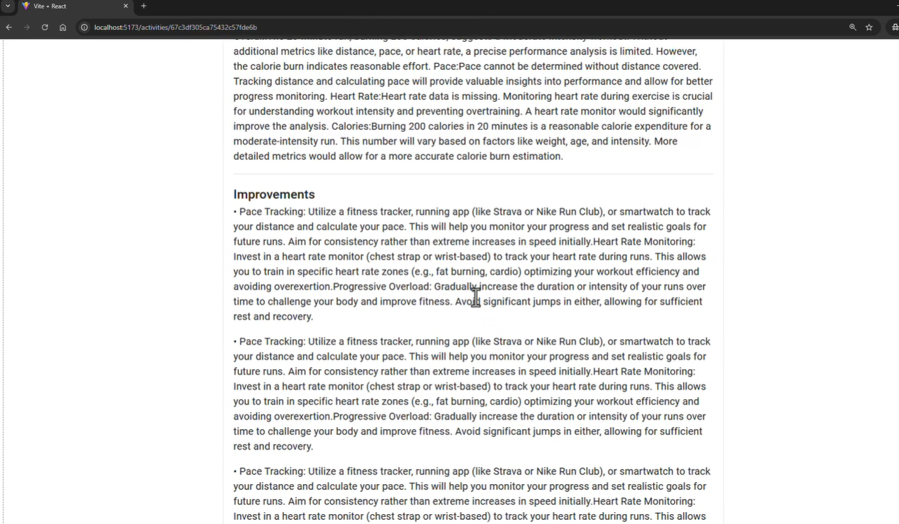

# 🏃 AI-Powered Health Activity Analyzer


<p align="center">
  <b>An AI-powered fitness tracking platform built with Java, Spring Boot, Microservices, React, and Google Gemini AI.</b>
</p>

<p align="center">
  
  
  
  
  
</p>
---

## 📌 Overview

**AI-Powered Health Activity Analyzer** is a full-stack fitness application that helps users track their physical activities and receive intelligent, AI-generated health insights and personalized fitness recommendations.

The application allows users to securely authenticate, record their daily activities, and analyze their fitness information through an AI-powered recommendation system.

Built using a **Microservices Architecture**, the platform consists of independently developed services that communicate through REST APIs and asynchronous messaging using RabbitMQ.

The AI Service integrates **Google Gemini AI** to transform activity data into meaningful fitness insights and recommendations.

## ✨ Features

- 🔐 **Secure Authentication:** User authentication and authorization using Keycloak and OAuth 2.0.
- 👤 **User Management:** User registration, validation, and profile management.
- 🏃 **Activity Tracking:** Create, store, and retrieve user activities.
- 🤖 **AI-Powered Analysis:** Analyze physical activities using Google Gemini AI.
- 💡 **Smart Recommendations:** Generate personalized health and fitness recommendations.
- ⚡ **Microservices Architecture:** Independent and modular backend services.
- 🔍 **Service Discovery:** Dynamic service registration using Netflix Eureka.
- ⚙️ **Centralized Configuration:** Manage configurations using Spring Cloud Config Server.
- 📨 **Asynchronous Communication:** Event-driven communication using RabbitMQ.
- 🌐 **React Dashboard:** Interactive frontend for user authentication, activity tracking, and AI recommendations.
- 🔗 **API Gateway:** Centralized routing and communication between frontend and backend services.

---

## 🛠️ Tech Stack

| Category                 | Technologies               |
| ------------------------ | -------------------------- |
| Programming Language     | Java                       |
| Backend Framework        | Spring Boot                |
| Microservices            | Spring Cloud               |
| API Gateway              | Spring Cloud Gateway       |
| Service Discovery        | Netflix Eureka             |
| Configuration Management | Spring Cloud Config Server |
| Authentication           | Keycloak, OAuth 2.0        |
| Messaging                | RabbitMQ                   |
| AI Integration           | Google Gemini AI           |
| Relational Database      | MySQL                      |
| NoSQL Database           | MongoDB                    |
| Frontend                 | React.js, JavaScript       |
| API Testing              | Postman                    |
| Build Tool               | Maven                      |
| Version Control          | Git, GitHub                |

---

## 🏗️ Microservices Architecture

The application follows a distributed microservices architecture where each service handles a specific responsibility.

### Services

| Service             | Description                                                                                            |
| ------------------- | ------------------------------------------------------------------------------------------------------ |
| **UserService**     | Handles user registration, user management, and authentication integration.                            |
| **ActivityService** | Manages user activities, including creating and retrieving activity records.                           |
| **AiService**       | Processes activity information and generates AI-powered recommendations using Google Gemini.           |
| **API Gateway**     | Acts as the centralized entry point for frontend requests and routes requests to appropriate services. |
| **Eureka Server**   | Provides service registration and discovery.                                                           |
| **Config Server**   | Provides centralized configuration management.                                                         |
| **Frontend**        | React-based user interface for authentication, activity tracking, and AI recommendations.              |

### 🔄 Application Workflow

1. Users access the application through the React frontend.
2. Keycloak handles user authentication and issues authentication tokens.
3. Frontend requests are sent through the Spring Cloud API Gateway.
4. The API Gateway routes requests to the appropriate microservice.
5. User activities are created and stored by the ActivityService.
6. RabbitMQ enables asynchronous communication between backend services.
7. The AI Service receives activity information and processes it using Google Gemini AI.
8. AI-generated health insights and personalized recommendations are made available to users.

---

## 📸 Application Screenshots

### 🔐 1. Authentication & User Management

**Keycloak Login**



**User Registration**



**User Validation**



---

### 🏃 2. Activity Management

**Creating User Activities**



**Viewing All Activities Based on User**



---

### 🤖 3. AI-Powered Health Recommendations

**AI Recommendation - Example 1**



**AI Recommendation - Example 2**



---

## 📂 Project Structure

```text
AI-Powered-Health-Activity-Analyzer/
│
├── AiService/
│   └── AI analysis and recommendation service
│
├── UserService/
│   └── User management service
│
├── activityservice/
│   └── Activity tracking service
│
├── gateway/
│   └── Spring Cloud API Gateway
│
├── configServer/
│   └── Centralized configuration server
│
├── eureka/
│   └── Service discovery server
│
├── frontend/
│   └── React frontend application
│
├── Assets/
│   └── Application screenshots
│
└── README.md
```

---

## ⚙️ Getting Started

### Prerequisites

Install the following tools before running the application:

- Java JDK
- Maven
- Node.js and npm
- MySQL
- MongoDB
- RabbitMQ
- Keycloak
- Git

### 1. Clone the Repository

```bash
git clone https://github.com/rohan-1505/AI-Powered-Health-Activity-Analyzer.git
```

Navigate into the project directory:

```bash
cd AI-Powered-Health-Activity-Analyzer
```

### 2. Configure Environment Variables

Configure the necessary application properties and environment variables for:

- MySQL database connection
- MongoDB connection URI
- RabbitMQ connection
- Google Gemini API key
- Keycloak server URL
- Keycloak realm and client configuration

**Security Note:** Never commit API keys, database credentials, access tokens, or other sensitive information to GitHub.

### 3. Start Infrastructure Services

Ensure the following infrastructure components are running:

- MySQL
- MongoDB
- RabbitMQ
- Keycloak

### 4. Start Backend Microservices

Start the services in the following order:

1. Config Server
2. Eureka Server
3. UserService
4. ActivityService
5. AiService
6. API Gateway

Make sure each service starts successfully before testing the application.

### 5. Start React Frontend

Navigate to the frontend directory:

```bash
cd frontend
```

Install dependencies:

```bash
npm install
```

Start the development server:

```bash
npm run dev
```

Open the local URL displayed in your terminal to access the application.

---

## 🔐 Security Implementation

The application integrates Keycloak for centralized identity and access management.

Security capabilities include:

- OAuth 2.0 authentication.
- Centralized identity management.
- Token-based authentication.
- Protected application endpoints.
- Role-based authorization where configured.

---

## 🤖 AI Integration

The AI Service integrates **Google Gemini AI** to analyze user activity information and generate personalized recommendations.

The AI-powered workflow aims to:

- Process user activity information.
- Analyze activity patterns.
- Generate meaningful fitness insights.
- Provide personalized recommendations.
- Help users better understand their physical activity.

*Note: AI-generated recommendations are informational and should not replace professional medical advice.*

---

## 🚀 Future Enhancements

- 📊 Advanced fitness analytics and interactive charts.
- 🎯 Personalized fitness goals and progress tracking.
- 📅 Historical activity reports.
- 🤖 More advanced AI-powered recommendations.
- 🐳 Docker-based deployment.
- ☁️ Cloud deployment.
- 🔄 CI/CD pipeline integration.

---

## 👨‍💻 Developer

**Rohan Mahajan**

Java Backend Developer | Spring Boot | Microservices | React | AI Integration

- **GitHub:** [rohan-1505](https://github.com/rohan-1505)
- **LinkedIn:** [Connect with me](https://www.linkedin.com/in/rohan-mahajan-a7172b228/)

---

## ⭐ Support

If you find this project interesting, consider giving it a ⭐ on GitHub!

Your feedback and suggestions are always welcome.

\<p align="center">   \<b>Built with ❤️ using Java, Spring Boot, React, Microservices, and AI.\</b> \</p>
